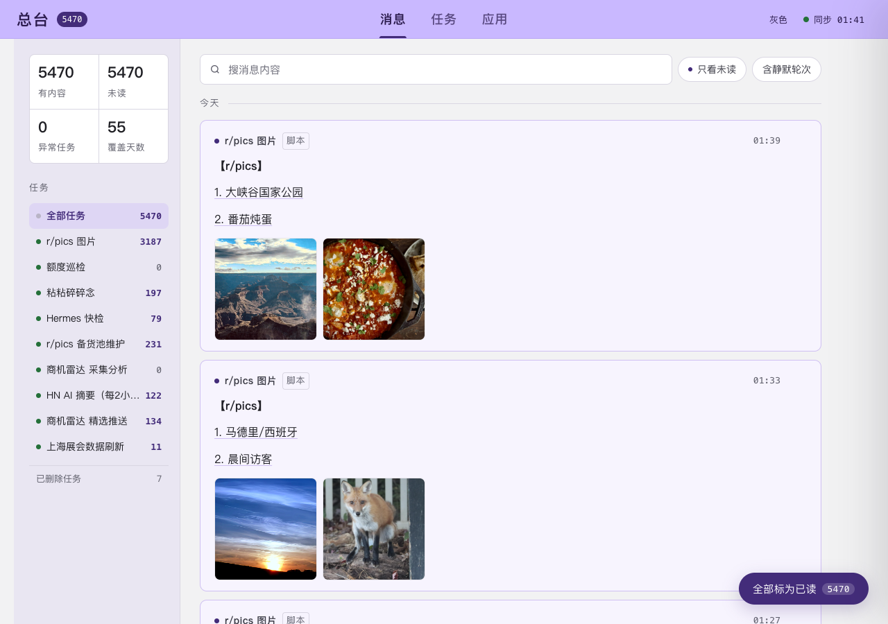
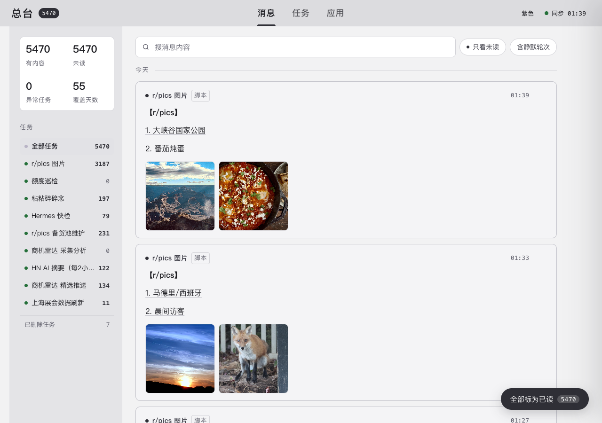
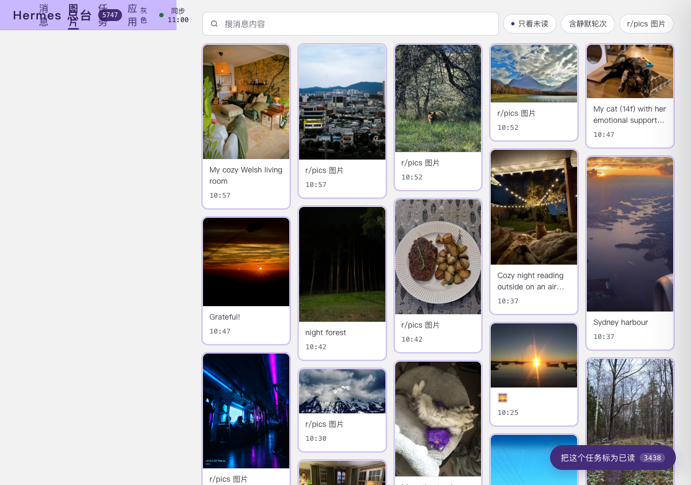

# my_hermes_manager

Hermes 定时任务的消息时间线，外加独立应用面板。界面标题 Hermes 总台。

## 功能

1. 时间线：全部任务消息按天倒序，未读有标记，长消息可折叠。
2. 图片墙：独立页签，4 到 6 列瀑布流随窗口宽度自适应并铺满整屏，缩略图按原图比例放大，右键可保存原图、分享到 X。
2. 检索与筛选：按任务、关键词、未读、静默轮次筛选，搜索词高亮，分页显示总数。
3. 任务健康：调度、投递目标、24 小时运行与产出、下次运行、失败连击与原始错误。
4. 已读水位：全局或单个任务标为已读，减少重复阅读。
5. 应用面板：在线服务直接内嵌打开，离线给出启动命令，内容目录可直接阅读。
6. 后台同步：launchd 每 5 分钟把 Hermes cron 输出落库，页面关着也不丢消息。
7. 主题：品牌紫与中性灰两套，选择保存在浏览器本地。
8. 深链：筛选、页码与单条消息写进 URL，刷新与分享都能回到原位置。

## 安装

需要 macOS 与 python3，没有第三方依赖。

```
git clone https://github.com/buxuele/my_hermes_manager.git
cd my_hermes_manager
./just_run.sh
```

脚本会拉起服务、探测端口、打开页面，已经运行时只打开页面并退出。
默认端口 8970，被占用时自动顺延，真实地址写在 .hub_state.json。

首次启动会安装 launchd 后台同步 com.fanchuang.hermes-hub-sync，每 5 分钟同步一次。

```
./uninstall_sync.sh
```

恢复后台同步：

```
./install_sync.sh
```

## 截图

消息时间线：



灰色主题：



r/pics 图片墙：



## 配置

apps.json 顶层字段：

| 字段 | 说明 |
|---|---|
| quiet_exempt | 允许长期静默的任务 ID 列表，这些任务不参与「久无产出」判定 |
| apps | 应用面板清单 |

apps 每项字段：

| 字段 | 说明 |
|---|---|
| key | 唯一标识 |
| name | 显示名 |
| desc | 一行说明 |
| type | service 本地 HTTP 服务，content 本地内容目录 |
| path | 目录，支持 ~ 与相对本项目的路径 |
| ports | 仅 service，按顺序探测这些端口 |
| health | 仅 service，健康检查路径，返回非 2xx 标为接口异常 |
| start_hint | 仅 service，离线时展示的启动命令 |
| recursive | 仅 content，是否递归列子目录 |
| depth | 仅 content，递归最大层数，默认 2 |

## 任务状态

只用真实数据，不猜。

| 状态 | 条件 |
|---|---|
| 正常 | 已启用，没失败，没超过调度周期，最近一次状态 ok |
| 故障 | failure_streak > 0 或最近一次状态不是 ok，卡片里显示原始错误 |
| 停摆 | 间隔任务超过 2.5 倍周期，或任何任务超过 next_run_at 的宽限时间未跑，宽限至少 15 分钟 |
| 久无产出 | 未列入 quiet_exempt，7 天内至少 10 条有内容，但最近 24 小时零产出 |
| 已暂停 | enabled = false |
| 无留档 | 任务在跑，但本库没有任何输出 |
| 已删除 | jobs.json 里已经没有这个任务，名字与最近产出从库里取 |

## 文件结构

| 文件 | 作用 |
|---|---|
| server.py | HTTP 服务与接口，标准库实现 |
| hub.py | 数据层：解析输出文件、增量入库、查询、已读水位、任务健康度 |
| sync_once.py | 后台同步入口，给 launchd 每 5 分钟调一次 |
| install_sync.sh | 安装 launchd 后台同步 |
| uninstall_sync.sh | 卸载后台同步 |
| just_run.sh | 启动入口，探测端口并打开页面 |
| apps.json | 应用面板与静默豁免清单 |
| static/ | 前端单页，无构建步骤 |
| tests/ | 数据层与服务端自测 |
| media_archive/ | 附件与图片归档，硬链接自各任务缓存，缓存清理后仍可访问 |
| 效果图/ | 桌面与移动端截图 |

## 接口

| 方法 | 路径 | 说明 |
|---|---|---|
| GET | /api/messages?page=1&size=30&job=&q=&unread=0&silent=0&until=&anchor= | 分页消息，anchor 定位到某条消息所在页 |
| GET | /api/overview | 统计、任务健康度、应用状态 |
| GET | /api/apps | 应用清单与状态 |
| GET | /api/apps/<key>/files | 内容类应用的文件列表 |
| GET | /api/file?path= | 读单个文本文件 |
| GET | /media?path= | 读图片，限制在白名单目录内，另存为时用原始文件名 |
| POST | /api/read | 标为已读，body 传 {"job": "任务ID"} 只标该任务 |
| POST | /api/sync | 立即同步一次 |
| GET | /health | 健康检查 |

## 测试

```
python3 -m unittest discover -s tests -v
```

## 已知限制

1. 同步时把图片与 markdown 附件硬链接进 media_archive，缓存清理后历史消息仍能打开；升级前就被删掉的图补不回，显示「图片已失效」。
2. 静默轮次默认不显示，打开「含静默轮次」才会出现。
3. 应用面板只探测端口与健康检查，不负责启动或停止别的服务。
4. 后台同步只能保住装上之后的输出，Hermes 滚掉的旧输出补不回。
5. 数据源固定读 ~/.hermes/cron，换机器要同时迁移 Hermes 的定时任务。
